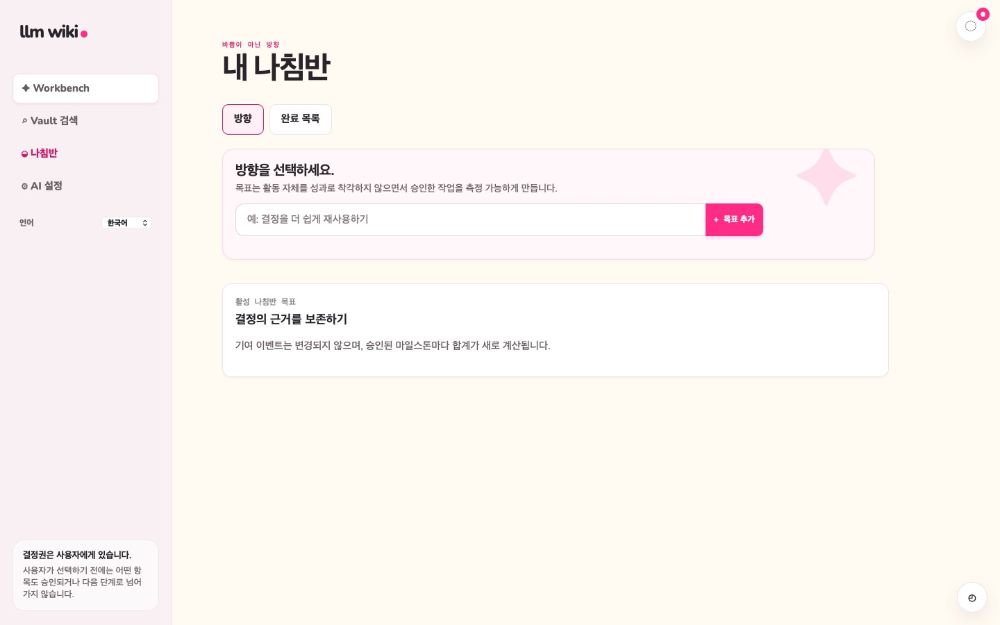

# Compass

[English](direction-dashboard.md) | **한국어**

> **Understand the work, never score the worker.**

> 화면 캡처: 2026-10-21 전체 App·공통 CSS·글꼴·실제 runtime을 비영구 WKWebView에서 합성 데이터로 렌더링했습니다. 설치 앱 캡처가 아닙니다. [캡처 조사](../testing/documentation-image-audit.md)를 참고하세요.

Compass는 목표, 근거 기반 Problem 중요도, 불변 마일스톤 이벤트, 방향 신호를 저장합니다. 이 신호는
업무와 목표의 관계를 설명할 뿐 생산성 점수나 직원 순위가 아닙니다.

제공자 장애 중에도 로컬 화면에서 기존 방향과 근거를 유지할 수 있습니다.

관련 Spec Kit: [004 — Direction Dashboard](../../specs/004-direction-dashboard/spec.md)

Compass는 방향과 완료 목록 탭을 제공합니다. 완료 목록에는 하위 작업을 포함한 전체 완료 Task가 완료 시각의 최신순으로 표시되며, 항목을 선택하면 공용 Task 모달의 Work 탭이 열리며, 저장된 Work Log 이력과 Sessions, Review의 연결된 Knowledge를 확인할 수 있습니다. Escape 또는 닫기를 누르면 해당 항목으로 포커스가 돌아오며, 배경 클릭은 모달을 닫지 않습니다. 완료된 Task의 근거는 읽기 전용으로 유지되고 새 메모와 별도 Knowledge 작업은 계속 사용할 수 있습니다. Task를 불러올 수 없으면 다른 Task를 추측하지 않고 재시도와 닫기 버튼이 있는 오류를 표시합니다. Workbench는 진행 중인 Task 옆 작은 목록에 최근 완료 5개만 표시하며, 대기 카드가 없는 카테고리는 숨깁니다.

최근 완료 패널은 옆 진행 중 Task 패널과 높이를 맞춥니다. 좁은 화면에서는 진행 중 Task 아래에 높이 320px로 표시됩니다. 제목은 고정되고 목록만 세로로 스크롤되며, 가장 최근에 완료한 작업이 맨 위에 표시됩니다.
