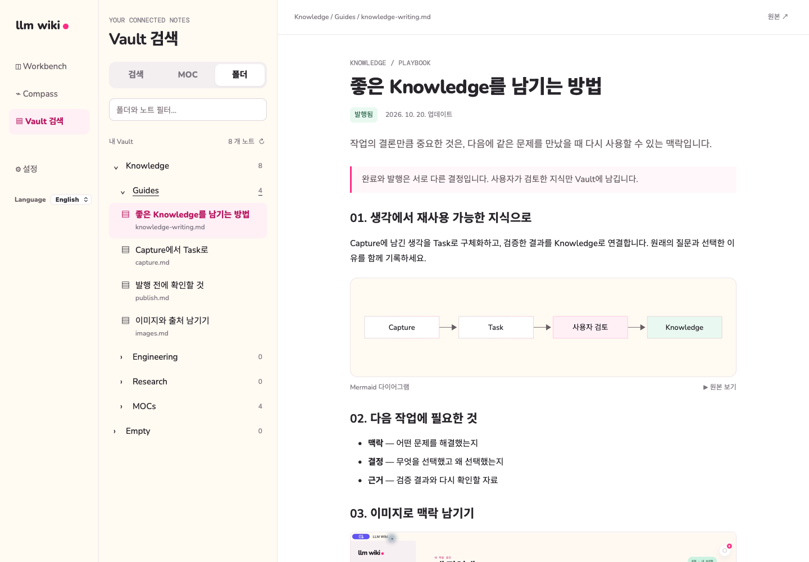

# 빠른 Vault 검색

[English](fast-vault-search.md) | **한국어**

모든 주요 화면은 같은 Sidebar 컴포넌트, 메뉴 순서와 앱 번역 키를 사용합니다. 순서는 워크벤치 → 나침반 → Vault 검색 → AI 설정입니다. 크림색 세로 메뉴는 페이지 왼쪽에서 176px 너비를 유지하며, 창 너비가 900px 이하면 76px 아이콘 메뉴로 줄어듭니다. 좁은 메뉴에서도 접근 가능한 메뉴 이름과 언어 선택기를 유지합니다. Vault로 이동해도 메뉴 위치·순서·이름이 바뀌지 않습니다. 650px 이하에서 Vault 목록과 리더는 기존 뒤로 가기 동작으로 전환하며 공통 세로 메뉴는 계속 표시됩니다.

> **Resume where you left off.** 검색은 이전 Knowledge를 현재 결정으로 다시 가져옵니다.

> 화면 캡처: 2026-10-23 실제 SearchView·Sidebar·공통 CSS·번들 글꼴을 합성 읽기 전용 API 데이터와 함께 비영구 WKWebView에서 렌더링했습니다. 설치 앱이나 사용자 Vault 캡처가 아닙니다. [시각 검토 기록](../../design/vault-navigation/IMPLEMENTATION.md). 이미지의 내비게이션은 공통 세로 메뉴 수정 이전 상태이며, 수정 후 넓은 창·좁은 창 캡처는 시각 확인을 기다리고 있습니다.

검색·MOC·폴더는 같은 흰 노트 리더를 사용합니다. 검색은 기존 키워드·의미 검색과 20개 단위 추가 결과를 유지합니다. 폴더는 실제 Markdown 계층과 빈 폴더를 보여주며, 새로고침은 원본 수정이나 재인덱싱 없이 목록을 다시 읽습니다. 펼치기와 폴더 선택은 별도 제어입니다. MOC는 `MOC/`·`MOCs/`의 노트, 이름이 `moc`로 끝나는 노트, YAML frontmatter의 `type: moc`·`information_type: moc`·`llm_wiki.information_type: moc` 선언을 표시합니다. MOC 링크 행은 작성된 레이블과 이어지는 설명을 묶어 보여주며 콘텐츠를 새로 생성하지 않습니다.

노트를 선택하면 상대 경로가 위에 고정되고 목록과 본문을 각각 스크롤할 수 있습니다. 넓은 화면의 본문 읽기 폭은 688px입니다. 원본 버튼은 Markdown을 읽기 전용으로 표시합니다. 이 리더는 관리 노트의 영문 canonical 원본 또는 일반 노트의 원문을 읽으며 자동 번역이나 발행을 시작하지 않습니다. 다른 기존 번역 화면은 그대로 유지합니다. 좁은 화면에서는 목록과 리더를 나누고 복귀 버튼으로 탭·필터·펼친 폴더·선택을 유지합니다. 현재 데스크톱 창의 최소 폭은 900px이며, 이전 390px 레이아웃은 렌더링 fixture로 검증했습니다. 현재 공통 세로 메뉴 수정 후 같은 너비의 시각 확인은 아직 완료하지 못했습니다.

기본/GFM Markdown, 코드 블록, 표, Mermaid와 로컬 PNG·JPEG·GIF·WebP 이미지를 지원합니다. Mermaid는 strict 설정과 정화한 SVG로 로컬 렌더링하며 실행 가능한 HTML, 콜백, HTML 레이블, 설정 덮어쓰기와 원격 리소스를 허용하지 않습니다. 잘못된 다이어그램은 이스케이프한 원본을 확인할 수 있고 나머지 노트는 계속 읽을 수 있습니다. 큰 다이어그램·코드·표는 자체 영역에서 스크롤합니다. 이미지는 노트 기준 상대 경로로 읽으며 상위 경로도 설정된 Vault 안에 있을 때만 허용합니다. 이미지는 닫을 수 있는 원본 크기 뷰어로 열립니다. 외부 이미지·SVG·절대 경로·symlink 이탈은 거부합니다. 이미지는 별도의 10 MiB 한도를 그대로 유지합니다. canonical/원본 노트와 탐색 메타데이터 읽기는 정확히 10 MiB(10,485,760바이트)까지 허용하며, 초과하면 원본을 변경하지 않고 오류를 표시합니다. 탐색은 Markdown 노트 10,000개까지 지원합니다. 기존 2 MiB는 native 파일 읽기 전에 데이터량을 제한한 guard였으며 브라우저 표준이나 렌더링 성능 실측에 근거한 수치는 아니었습니다. 대용량 Markdown의 UI 렌더링 성능은 측정하지 않았습니다.

`[[노트|레이블]]`, `[[노트#제목]]`과 상대 Markdown 노트 링크는 같은 리더에서 엽니다. 짧은 파일명은 하나로 해석될 때만 이동하며 없는 링크나 중복 이름은 비활성으로 남습니다. 외부 링크는 표시하되 이 리더에서 브라우저를 열지 않습니다. 로딩·빈 폴더·검색 실패·노트 실패·이미지/다이어그램 오류는 맥락을 유지하고 필요한 재시도나 취소 제어를 제공합니다. 노트 이동 이력과 스크롤 위치는 열린 화면 안에서 유지하며 앱을 다시 시작하면 초기화됩니다.

탭과 현재 노트의 선택 배경은 즉시 바뀌며, 활성 탭은 실제 표시되는 목록과 일치합니다.

Obsidian 호환 Markdown의 Vault 상대 경로, 제목, heading, 본문을 인덱싱합니다. 버전이 있는
`llm_wiki` YAML 블록으로 명시적인 적용성, 주제별 결정, 아이디어 상태 metadata를 추가할 수
있습니다. Metadata가 없거나 잘못되어도 본문 검색은 유지되며 최종 결정을 만들어 내지 않습니다.
복구본, 철회본, 번역본은 원본 인덱스에서 제외됩니다.
로컬 데이터베이스는 범위가 제한된 section unit과 aspect별 vector를 Markdown과 별도로
보관합니다. 파일이 변경·이동·삭제되면 원본 note를 다시 쓰지 않고 재구성 가능한 인덱스만
증분 갱신합니다.

Semantic 검색은 명시적으로 선택할 때 사용합니다. Exact keyword 일치와 독립적으로 semantic
후보를 모은 뒤 pagination 전에 lexical·semantic 순위를 결합합니다. 적용성에는 더 높은 가중치를
주고, 명시적으로 검증되지 않은 아이디어는 불확실한 상태를 유지합니다. 네이티브 데스크톱 앱은
고정된 다국어 MiniLM ONNX 모델을 포함하므로 모델 다운로드나 Python Runtime이 필요하지 않습니다.
모델·임베딩 장애 중에도 구조 검색은 동작합니다. 결과는 계산된 원본 revision을 보존하고 최대 8개
evidence passage를 반환합니다. Vector input과 고정된 model identity가 일치할 때만 기존 vector를
재사용하며, inference 중 원본 revision이 바뀌면 늦게 도착한 결과를 저장하지 않습니다.

관련 Spec Kit: [001 — Fast Vault Search](../../specs/001-fast-vault-search/spec.md),
[018 — Multi-aspect Knowledge Retrieval](../../specs/018-multiaspect-knowledge-retrieval/spec.md)
