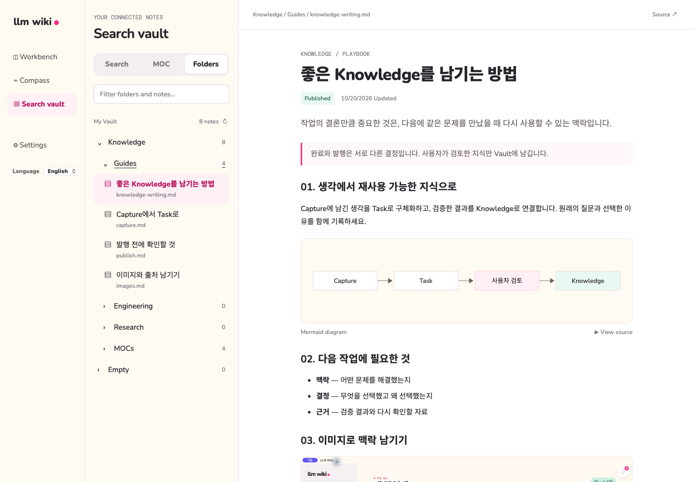

# Fast vault search

**English** | [한국어](fast-vault-search.ko.md)

> **Resume where you left off.** Search brings prior Knowledge back into the current decision.

> Screenshot: shipping SearchView and Sidebar with shared CSS and bundled fonts, rendered in an isolated nonpersistent WKWebView with synthetic read-only API data on 2026-10-23. This is fixture evidence, not an installed-app or personal-Vault capture. [Visual review](../../design/vault-navigation/IMPLEMENTATION.md).

The main navigation shares the Vault rail’s cream surface, flat menu buttons and pink current-view highlight across Workbench, Compass and AI setup. Each view retains its existing navigation labels, order and responsive layout widths.

Search, MOC and Folders share one white note reader. Search retains lexical/semantic retrieval and 20-result pagination. Folders show the live Markdown hierarchy and empty folders; Refresh reads the listing again without reindexing or modifying files. Each folder has separate disclosure and selection controls. MOC lists authored notes in `MOC/` or `MOCs/`, names ending in `moc`, or notes declaring `type: moc`, `information_type: moc`, or `llm_wiki.information_type: moc` in YAML frontmatter. MOC link rows preserve authored labels and optional following descriptions; they do not generate new content.

Selecting a note keeps its relative breadcrumb visible while the list and reader scroll independently. The article uses a 688px reading width at large viewports. Source toggles the original Markdown as read-only text. This reader serves canonical English for managed notes and original text for other notes; it never starts automatic translation or publication. Other existing translation surfaces are unchanged. Narrow layouts separate the list and reader, with a visible back action that keeps the tab, filter, expanded folders and selection. The desktop window currently has a 900px minimum width; the 390px layout is verified in the rendering fixture.

The reader supports basic/GFM Markdown, fenced code, tables, Mermaid and local PNG, JPEG, GIF and WebP images. Mermaid runs locally with strict configuration and sanitized SVG; executable HTML, callbacks, embedded HTML labels, configuration overrides and remote resources are not enabled. Invalid diagrams expose escaped source and leave the rest of the note readable. Large diagrams, code and tables scroll inside their own frames. Images resolve relative to the note, may use parent paths only while remaining inside the configured Vault, and open at full size in a closable viewer. External images, SVG, absolute paths and symlink escapes are rejected. Images retain their separate 10 MiB limit. Canonical/original note reads and navigation metadata reads accept files up to and including 10 MiB (10,485,760 bytes); larger notes show an error without changing the source. Navigation supports up to 10,000 Markdown notes. The former 2 MiB guard bounded data before native file reading; it was not a browser standard or a measured rendering cutoff. Large-Markdown UI rendering performance has not been measured.

`[[note|label]]`, `[[note#Heading]]` and relative Markdown note links open in the same reader. Short filenames must resolve uniquely; missing or ambiguous links remain inert. External links are displayed without opening a browser from this reader. Loading, empty folders, search failures, note failures and inline image/diagram failures retain context and provide appropriate retry or cancellation controls. Note history and scroll positions are kept in the mounted view, not persisted across app restart.

Tab and current-note selection surfaces update immediately, and the active tab always names the displayed list.

Search indexes Vault-relative paths, titles, headings, and body text from Obsidian-compatible
Markdown. A versioned `llm_wiki` YAML block may add explicit applicability, topic-specific decision,
and idea status metadata. Missing or invalid metadata leaves body search available and never creates
a final decision. Recovery, withdrawal, and translated copies are excluded from the source index.
The local database keeps bounded section units and per-aspect vectors separately from the Markdown;
changed, moved, and deleted files update that rebuildable index without rewriting source notes.

Semantic retrieval is available when explicitly selected. It collects semantic candidates
independently from exact keyword matches, then combines lexical and semantic ranks before pagination.
Applicability receives more weight, while explicitly unverified ideas remain qualified. The native
desktop app packages the pinned multilingual MiniLM ONNX model and needs no model download or Python
runtime. Structural search remains a fast local fallback during model or embedding failure. Results
retain their computed source revision and return at most eight evidence passages. Vectors are reused
only when their input and pinned model identity match, and a delayed vector result is discarded when
the source revision changed during inference.

Related Spec Kit: [001 — Fast Vault Search](../../specs/001-fast-vault-search/spec.md),
[018 — Multi-aspect Knowledge Retrieval](../../specs/018-multiaspect-knowledge-retrieval/spec.md)
