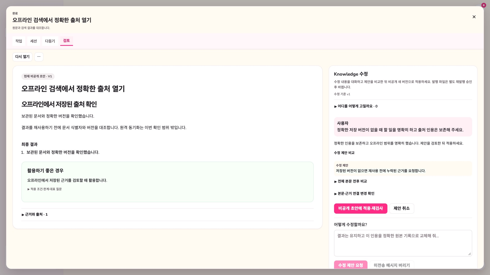

# Knowledge 초안과 수정 채팅

[English](knowledge-distillation.md) | **한국어**

## 상세한 경험담과 선택적 claim 메타데이터 (2026-11-05)

새 초안과 채팅 수정은 내가 무엇을 시도하고 수행했는지, 어떤 대안과 결정을
기록했는지, 어떤 결과·실패·한계·배움이 있었는지를 상세한 1인칭 경험담으로
작성합니다. AI·도구가 수행한 일은 정확히 구분하며, 계획이나 보고된 결과를
독립적으로 검증된 결과로 바꾸지 않습니다. 기록이 적으면 세부 경험을 지어내지
않습니다.

claim·가정 메타데이터는 선택 사항입니다. 누락되거나 형식이 잘못된 선택적
항목은 본문을 버리는 대신 진단 경고로 남깁니다. 보고된 경험을 자연스럽게
풀어 쓸 때 출처 원문과 문장을 일치시킬 필요는 없습니다. 제공된 출처 식별자와
정확한 인용은 보존하지만, 인용 자체가 바꿔 쓴 문장을 검증하지는 않습니다.
바꿔 쓴 문장은 검증된 사실이 아니며, 모순 가능성을 검토할 수 있도록 경고에
제안 문장과 기록된 인용을 함께 표시합니다. 적용 범위·본문 위치 같은 선택적
연결 문제는 안내로 처리합니다. 허위 검증·최종
결정 권한, 유효하지 않은 출처, 중요한 누락과 실제 차단 finding은 여전히 검토가
필요합니다. 오래된 head·소유권·트랜잭션 보호는 유지합니다.

모델의 의미 구조 때문에 완료된 Task의 Knowledge 준비가 막히면 저장된 Run
보고서·실패 근거·정식 완료 기록을 사실 기반 대체 결과로 보존하고 경고를
남깁니다. 의미 요약이 없는 다른 Run의 원문·완료된 명령 근거도 따로 수집합니다. 검증 성공을 추론하거나 Task·완료 기록을 다시 쓰지 않습니다. 수정이
포함된 빌드를 사용한 뒤 Knowledge 초안 생성을 다시 명시적으로 요청하세요. Queue 재시도는 같은
프롬프트 버전의 요청에 사용할 수 있으며, 이전 버전 요청이면 새 초안 생성이
필요합니다. 결과 본문과 경고를 검토한 뒤 적용·
발행하세요.

## 발행·출처 정책 변경 (2026-10-21)

사용자 경험과 설명은 그 자체로 사용자 진술 출처입니다.
해당 설명이 있는 채팅 메시지는 작성자와 정확한 원문을 보존하며 AI 해석과 구분합니다.
발행 승인이 작성자를 바꾸지는 않습니다. 인용 없는 내용도 정상 문서입니다.
직접 인용을 제공한 경우에는 정확한 원문 검사를 유지하며, 거절된 인용은 확인 사항으로
남고 인증된 원문처럼 표시하지 않습니다.

채팅 제안은 확인 사항을 보존한 채 적용할 수 있습니다. 적용은 현재 버전과 원본 스냅샷을
재확인하고 본문·연결 정보를 새 비공개 버전으로 함께 저장합니다. 발행은 별도의 버튼 한 번으로
수행하며 의미·품질 확인 사항은 발행을 막지 않습니다. [발행 안내](knowledge-archive.ko.md)를 참고하세요.

Work Log 이미지와 이전 이미지 저장 형식도 근거 스냅샷에 포함하고 생성·수정 요청의
이미지 입력으로 전달합니다. base64는 텍스트 인용 목록에서 제외합니다. 이미지 존재만으로
모델이 픽셀을 읽었다고 판단하지 않습니다. 픽셀 누락과 미지원 이미지 형식은 문맥에 구분해
남기며, provider의 이미지 요청 거절은 이미지 입력 오류로 알립니다.

Enter는 전송, Shift+Enter는 줄바꿈이며 한국어 조합 Enter는 전송하지 않습니다.
대화만 독립적으로 스크롤합니다. 채팅 중 X/Escape로 바로 닫을 수 있고 같은 앱에서
재진입하면 Task·버전별 입력·대화·진행/완료 상태를 복원합니다. 취소는 별도 동작입니다.
앱을 재시작한 뒤 요청 재개까지 보장하는 기능은 아닙니다.

AI 생성은 공통 AI 요청 Timeout 설정을 사용합니다. 새 버전은 생성 입력을 고정해 보존하고 저장 전 원본·현재 버전 변경을 검사합니다. 완료 상태만으로 결정·검증 권한을 만들지 않습니다. 아이디어는 상태와 재검토 조건을 갖는 별도 기록입니다. 비공개 의견은 채팅이나 본문 자동 수정과 구분합니다.

### 채팅 수정 제안 적용
선택한 제안과 원문/수정안 비교, 적용·취소는 왼쪽 문서 영역에 표시합니다.
오른쪽 채팅은 요청과 대화에 집중합니다. 진단 숫자와 펼침 항목은 같은
정규화 목록을 사용하며, 긴 항목은 대화 스크롤 안에서 읽을 수 있습니다.

구조적으로 준비된 후보만 적용할 수 있습니다. 저장된 스냅샷에 없는 출처나
틀린 직접 인용은 인증된 연결에서 제외하고 확인 사항으로 남깁니다.
검증된 사실로 바꾸지 않습니다. 적용 데이터가 없는 이전 제안은 저장된
후보·스냅샷으로 복구합니다. 기준 버전과 현재 비공개 버전 검사는 유지합니다.
오래된 제안은 원문과 입력을 보존하며 ‘제안 갱신 요청’으로 이전 제안을
새 요청의 문맥에 포함할 수 있습니다.

topic 갱신은 의미 노드와 동일하게 제한된 변경 범위를 따릅니다. 현재 노드가 없는
topic이나 과거 대체 노드를 가리키는 topic도 기존 키를 보존합니다. 원본과 완전히
같은 읽기 전용 topic 정보는 새 topic 버전을 쓰지 않고 유지하며, 이를 이용해 상태·
출처·노드 연결을 바꿀 수 없습니다. Work Log와 Journey를 저장하기 전에 native
트랜잭션이 저장된 topic 전체와 다시 비교합니다. 새 근거가 있는 topic은 허용된
후보 범위 안에서 추가할 수 있습니다. 거절된 변경은 기존 그래프와 이력을 보존하며,
초안 준비는 Journey 선행 작업의 실패를 표시합니다.

수정 요청도 AI Queue에서 모델·관찰한 API 호출·상태·원래 화면 링크를 표시합니다. 요청 완료는 제안 또는 확인 질문의 준비가 끝났다는 뜻이며 비공개 초안 적용이나 발행을 뜻하지 않습니다. 큐 취소는 진행 중인 요청에만 적용합니다. 저장된 제안과 입력 보존, 명시적인 비공개 적용·발행 검사는 기존 경로가 계속 담당합니다.

## 재사용을 위한 문서 작성

초안 생성과 수정 대화는 출처가 뒷받침하는 작업 배경, 실제 수행 내용,
결과물과 정리 방식, 대안과 판단 기준을 포함한 결정을 독립적인 문서로
구성합니다. 주제에 맞는 구조를 사용하며 빈 제목이나 기록 행위 자체에
대한 설명을 채우지 않습니다. 사용자 경험 진술에 외부 증명을 요구하지
않습니다. 제안과 실행은 구분하고, 중요한 한계는 해당 단계나 결과 옆에
설명합니다. 활용 안내는 정확한 출처 연결을 유지하면서 본문에 내부 분류
라벨을 강제하지 않습니다.

예를 들어 “답장 초안을 기록했다. 검증된 흐름은 아닙니다” 대신
“고객별 답장 초안을 `drafts/`에 모아 후속 검토에 사용할 수 있게 정리했다.
발송 전에는 수신자와 내용을 확인한다”로 설명합니다. 실제 발송을 주장하지
않습니다. 수신자가 스프레드시트를 사용해서 CSV를 선택했다면 그 전달 기준을
설명하며, 수행하지 않은 성능 비교 결과를 만들지 않습니다.

### 원본 이미지

생성 상태가 갱신되어도 같은 원본 이미지와 열린 원본 크기 뷰어를 유지합니다. 이미지 참조가 바뀌면 새 원본을 읽으며, 뷰어를 닫으면 열었던 버튼으로 초점을 되돌립니다.

Capture, 작업로그, 세션 기록의 이미지는 Knowledge 출처 스냅샷에 보존됩니다.
생성과 수정은 이미지 목록을 받아 시각 자료의 문서상 가치와 사용자 의도에 따라
활용을 판단합니다. 의미 있는 시각 자료는 설명 옆에 원본 이미지로 남기며,
텍스트만 전달하는 캡처는 판단 근거를 남기고 본문에 통합할 수 있습니다.
활용 판단이 누락되면 원본을 유지합니다. 이전 형식의 수정 응답이 해당 필드를
생략해도 기존 판단은 유지합니다.

이미지는 앱이 저장된 스냅샷에서 읽는 불변 `llm-wiki-image:` 참조를 사용합니다.
초안과 발행된 Vault 읽기 화면에서 원본 크기로 열 수 있고, 실패 시 해당 위치에서
다시 시도할 수 있습니다. 원래 첨부를 수정하거나 제거해도 저장된 이미지는
바뀌지 않습니다. 입력 스냅샷 밖의 참조는 거부합니다. 임시 경로나 외부 업로드,
추적 URL을 만들지 않습니다. 내보낸 Markdown의 내부 이미지 링크를 읽으려면
로컬 앱 데이터베이스가 필요하며 다른 Markdown 리더용 독립 이미지 파일은 아닙니다.

기존 응답에는 `claimBindings.bodyLocator`가 없어도 됩니다. 이 필드는 재서술한
본문의 정확한 위치를 가리키며 원문 주장과 인용문은 유지합니다. 선택 필드인
`article.imageDecisions`에는 imageRef, disposition (`preserve_visual`,
`text_integrated`, `omit`), rationale, 선택적인 bodyLocator를 저장합니다.
통합된 텍스트는 본문에 있어야 하며 생성과 수정에 같은 스키마를 사용합니다.
