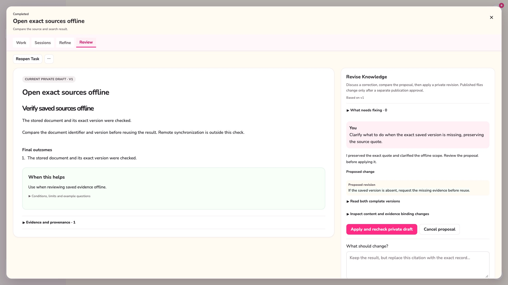

# Knowledge drafts and revision chat

**English** | [한국어](knowledge-distillation.ko.md)

## Publication and source policy update (2026-10-21)

User experience and explanation are primary user-reported sources.
A chat message containing such a report is captured with its author and exact words;
AI interpretation stays separate. Publication approval never changes authorship.
Citation-free content is normal. Supplied direct quotations still use exact-source
validation; rejected quotes are review notes, not authenticated source excerpts.

Chat proposals may apply with retained quality findings. Apply saves a coordinated
new private revision and rechecks the current head/source snapshot. Publication is
a separate single button action; semantic findings do not block it. See
[Knowledge publication](knowledge-archive.md).

Work Log image attachments, including legacy images, are frozen in the evidence
snapshot and sent as multimodal inputs in draft and revision requests. Base64 bytes
are excluded from the textual citation catalog. Attachment presence does not prove
the model read the pixels. Unavailable pixels and unsupported image media stay
explicit in context; provider image rejection is an image-input error, not a claim
that the user has no evidence.

Enter sends, Shift+Enter adds a newline, and composing Enter never sends. The
conversation scrolls independently of its composer. X/Escape close during chat;
reopening in the same app restores the Task/version input, history and running or
completed request. Cancel is separate. App restart does not promise request resume.

AI generation uses the shared AI Request Timeout setting. New versions preserve the frozen generation inputs and check source/head changes before atomic save. Completion alone never grants decided or verified authority. Ideas remain separate with their disposition and reconsideration conditions. Private review notes are separate records, not chat messages or automatic body changes.

### Applying a chat correction
The document column contains the selected proposal, before/after comparison,
Apply and Cancel. Chat contains requests and conversation. Diagnostic counts use
the same normalized rows that are rendered; expanded notes scroll with the
conversation instead of a second clipped details viewport.

Apply is offered only for a structurally prepared candidate. Rejected quotes,
including identities outside the saved snapshot, are retained as advisory findings
and removed from authenticated bindings. They are never marked verified. Legacy
proposals missing prepared bytes are rebuilt from their persisted candidate and
snapshot before applying. Exact base/private-head checks still reject stale work.
Request an updated proposal to carry the saved suggestion into a new request;
the original proposal and unsent input remain available.

Topic updates use the same bounded mutation scope as semantic nodes. Existing
keys remain reserved, including topics without a current node and topics with
historical replacement endpoints. Unchanged read-only topic metadata is preserved
without writing a new topic revision; it cannot be used to change status, sources,
or node pointers. The native transaction compares the complete stored topic again
before publishing Work Log or Journey updates. New supported topics may still be
added inside the candidate boundary. A rejected change preserves prior graph and
history, and draft preparation surfaces a failed Journey prerequisite.

Revision requests appear in AI Queue with model, observed API calls, status and an original-screen link. A completed request means a proposal or clarification was prepared; it does not mean the private draft was applied or published. Queue cancellation only cancels an active request. Saved proposals, user input retention and explicit private apply/publication checks keep their existing owners.

## Writing for reuse

Draft generation and revision chat organize supported background, work performed,
outputs and their organization, and decisions with alternatives and criteria into
a standalone document. Structure follows the subject; empty headings and routine
recording commentary are unnecessary. User reports do not need external proof.
Proposals remain distinct from executed actions, and consequential limitations
appear beside the step or result they affect. Reuse guidance retains exact source
bindings without requiring visible provenance labels in the article.

For example, replace “I recorded customer reply drafts; this is not a verified
workflow” with “Customer reply drafts are organized by customer in `drafts/` for
review. Check recipients and content before sending.” This does not claim the
replies were sent. Likewise, a recorded choice of CSV for a spreadsheet recipient
should explain that handoff criterion, rather than inventing a performance result.

### Original images

Capture, Work Log and session-note images are frozen with the Knowledge source
snapshot. Generation and revision receive an image catalog and assess each visual
for its documentary value and user intent. Meaningful visuals stay beside their
explanation as original images; text-only screenshots can be integrated into prose
with an explicit assessment. Missing assessments retain the original visual.
Revisions preserve existing assessments when an older response omits the field.

Image links use immutable `llm-wiki-image:` references resolved locally by the
app from saved snapshots. They render in draft and published Vault reading views,
including full-size viewing and inline retry on failure. Editing or removing the
original attachment does not change a saved image. References outside the supplied
snapshot are rejected. No temporary paths, remote uploads or tracking URLs are
created. These internal links require the local app database when reading exported
Markdown; they are not standalone image files for other Markdown readers.

`claimBindings.bodyLocator` is optional for older payloads. It identifies exact
paraphrased prose while source statements and quotes remain unchanged. Optional
`article.imageDecisions` holds imageRef, disposition (`preserve_visual`,
`text_integrated`, `omit`), rationale and an optional bodyLocator. Integrated text
must occur in the body. These fields use the same schema in generation and revision.
