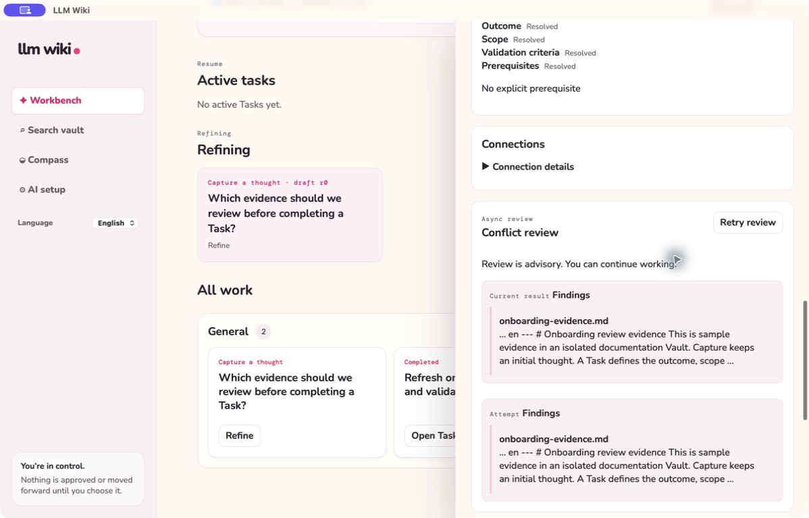
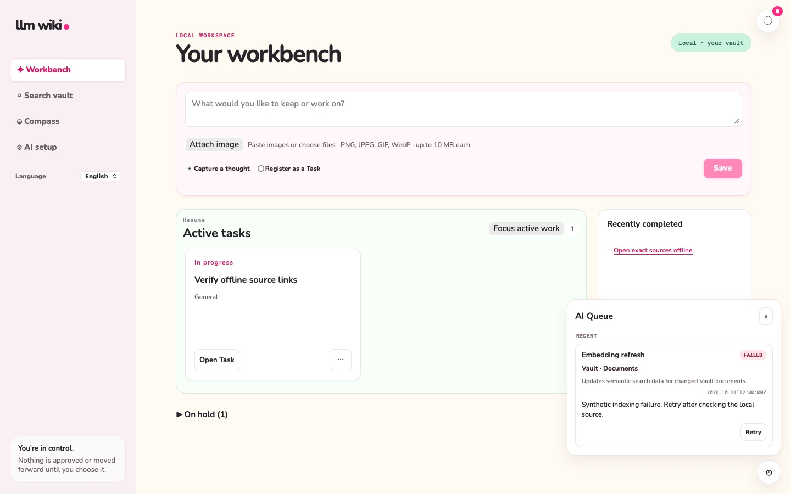

# Vault evidence for Task conflict review

**English** | [한국어](vault-conflict-evidence.ko.md)

Task conflict review uses saved Task context and selected Vault evidence to produce a cited, asynchronous report. The Queue preserves attempts and their status, so the Workbench remains usable while a review runs.

> Historical screenshot: `ConflictReviewPanel` is retained as a component/API contract but is not mounted by the current App at `584ae3c`. The image is preserved as previous-interface evidence, not an available Task screen. See the [image audit](../testing/documentation-image-audit.md).

> Screenshot: full App rendered in an isolated nonpersistent WKWebView on 2026-10-21 with synthetic data, shared CSS/fonts and production runtime. This is browser fixture evidence. [Capture audit](../testing/documentation-image-audit.md).

Treat a report as evidence, not a workflow gate. Read its citations and decide what to change in the Task yourself; no report marks a Task clear, advances its state, or replaces completion evidence. A changed Task revision or relevant Vault context makes the old report stale.

The former browser cancellation, batched Solution-claim screening, and clear/conflicted gate are legacy implementation history. They may remain readable in migrated records but are not controls promised by the current Task interface.

See [Task conflict review](conflict-resolution-workflow.md) and historical [specification 008](../../specs/008-vault-conflict-evidence/spec.md).
