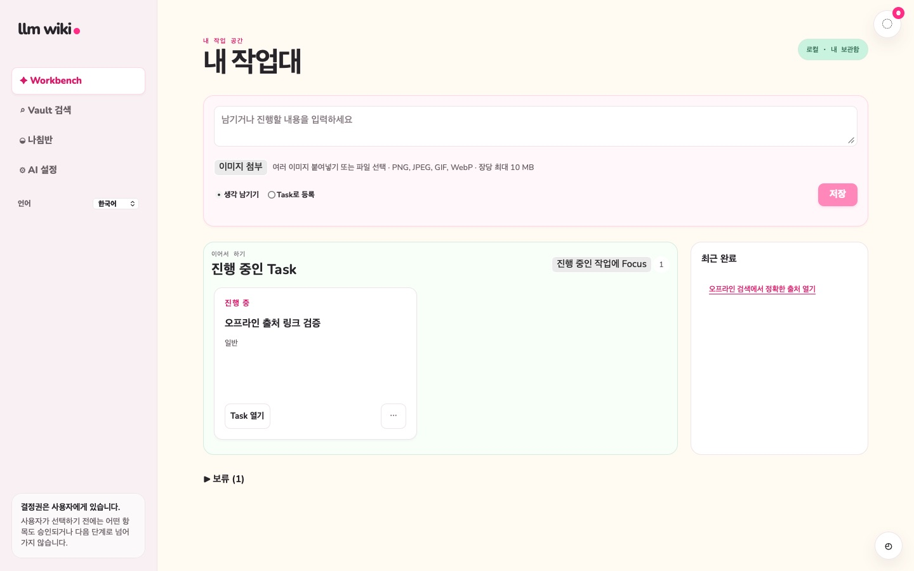
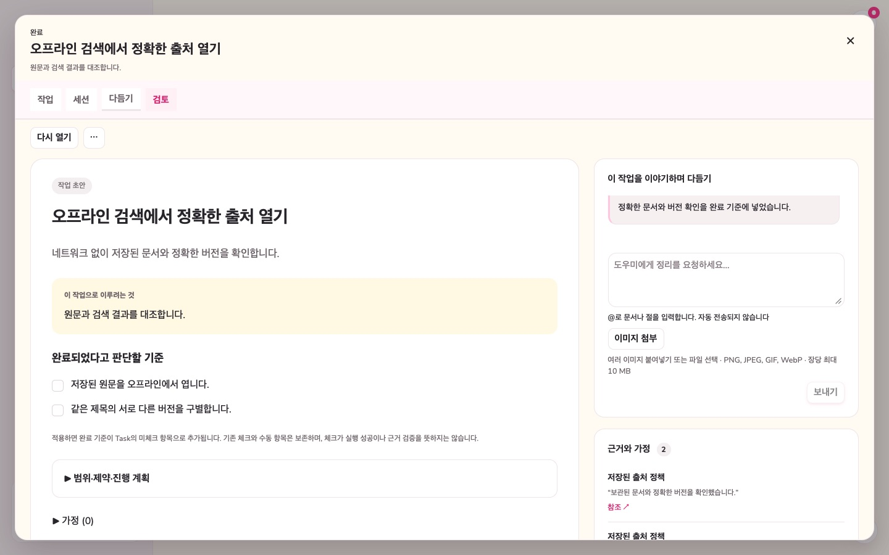
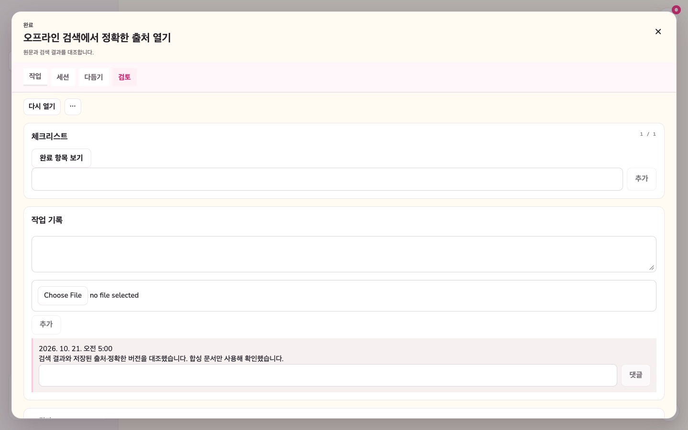
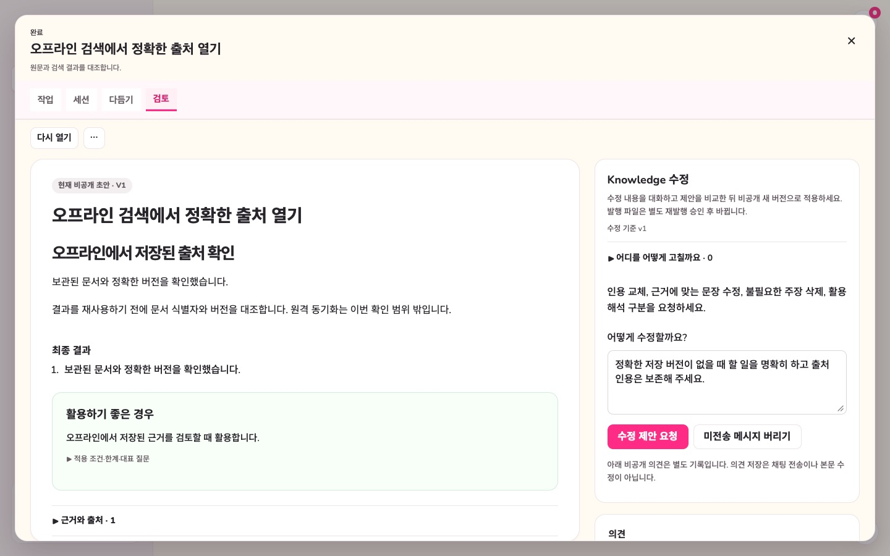
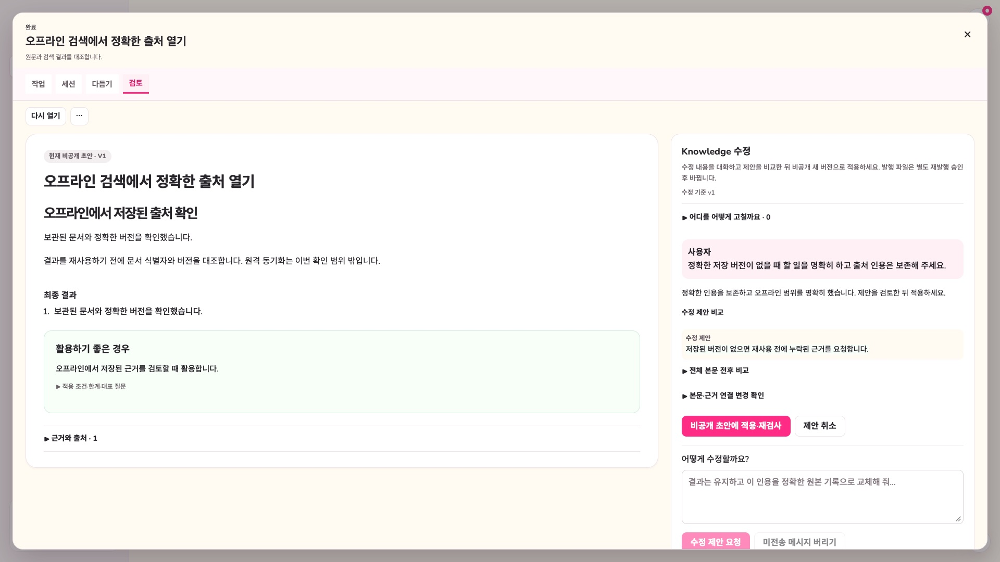
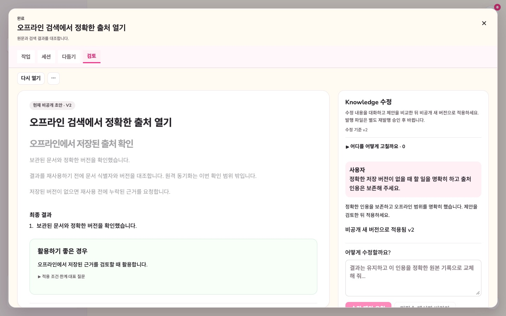

# 현재 인터페이스 안내

[English](visual-guide.md) | **한국어**

2026-10-21 통합 소스 `584ae3c`의 전체 App과 실제 runtime을 비영구 WKWebView에서
공통 CSS·번들 글꼴·합성 API 응답으로 렌더링했습니다. 설치 앱 캡처가 아니며 사용자 DB,
실제 모델이나 API 키를 사용하지 않았습니다.
[이미지 목록과 재현 절차](../testing/documentation-image-audit.md)를 참고하세요.

## 1. 아이디어를 Capture하거나 Task로 등록하기

기본 내비게이션은 **Workbench**, **Vault 검색**, **나침반**, **AI 설정**으로 이동합니다.
Workbench 입력을 Capture로 저장하거나 Task로 등록합니다. 진행 중 작업, 최근 완료와
보류 작업을 보드에서 확인합니다. **진행 중인 작업에 Focus**로 현재 작업 공간을 넓힙니다.

*입력 아래에는 진행 중 작업과 최근 완료가 표시되고 보류 영역은 접혀 있습니다.*

[Task 중심 Workbench](conflict-gated-workflow.ko.md)와
[Capture 자동 정리](capture-auto-distillation.ko.md)를 참고하세요.

## 2. Task 안에서 다듬기

**다듬기** 탭에는 저장된 작업 초안과 대화·근거 영역이 함께 있습니다. Task 정의 값은
프리뷰 위치에서 계속 편집할 수 있으며 중복 정의 영역은 제거됐습니다. 목표, 완료 기준,
범위, 제약, 접근법과 가정을 검토한 뒤 Task에 적용합니다.

*1440px 화면의 대화 영역은 약 429px입니다. 프리뷰와 Knowledge 채팅은 같은 폭을 사용하며
1920px에서는 약 583px, 2560px에서는 720px입니다.*

`@`로 저장된 문서나 절을 멘션합니다. 정확한 문서 버전과 출처 역할을 구분해 보존합니다.
메시지 전송, 출처 발견이나 초안 열기만으로 제안을 적용하지 않습니다. 저장된 초안 편집과
명시적인 Task 적용은 별도 동작입니다.

[근거를 반영하는 작업 초안](reference-aware-workbench.ko.md)을 참고하세요.

## 3. 네 개의 Task 탭에서 작업하기

탭은 **작업**, **세션**, **다듬기**, **검토** 순서입니다. 작업에는 체크리스트와 Work Log,
세션에는 저장된 작업 대화와 명시적 Codex 실행이 있습니다. 다듬기에서는 프리뷰·정의 편집·
다듬기 대화를 사용하고 검토에서는 완료와 Knowledge를 검토합니다. 채팅 응답이 Task를
완료하거나 발행하지는 않습니다.

*저장된 Work Log는 합성 출처·버전 확인을 설명합니다. 체크만으로 실제 수행이나 검증을
증명하지 않습니다.*

브라우저 파일 선택기 문구는 호스트 시스템 언어를 따르므로 한글 fixture에서도 영어로
표시될 수 있습니다. 제품 문구와 작성된 합성 내용은 문서 언어에 맞췄습니다.

[Task 작업 세션](task-work-sessions.ko.md)과
[Task 계보와 Knowledge](lineage-knowledge-layer.ko.md)를 참고하세요.

## 4. 발행 전에 Knowledge 수정하기

Task 완료 후 검토에는 비공개 Knowledge 초안과 별도의 수정 대화가 있습니다. 범위가 명확한
수정을 요청할 수 있으며 아래 이미지의 입력은 아직 전송하지 않은 상태입니다. 비공개 의견은
별도 기록이며 저장만으로 채팅을 전송하지 않습니다.

응답으로 받은 제안을 비교한 뒤 적용합니다. 적용은 비공개 새 버전을 추가합니다. 발행에는
별도의 아카이브 제안과 정확한 파일에 대한 명시적 승인이 계속 필요합니다.

*적용한 초안도 비공개입니다. 이 캡처는 네이티브 발행·출처 색인이나 실제 모델의 올바른
수정 능력을 검증하지 않습니다.*

[근거에 묶인 Knowledge 초안](knowledge-distillation.ko.md),
[검토 후 지식 아카이빙](knowledge-archive.ko.md),
[완료와 Knowledge](completion-writeback-archive.ko.md)를 참고하세요.

## 역사적 화면 기록

기존 `current-*` JPEG와 이전 PNG는 당시 인터페이스 기록으로 변경하지 않았습니다.
[네이티브 캡처 manifest](../testing/evidence/current-interface.json),
[언어 캡처 manifest](../testing/evidence/docs-language-consistency.json),
[입력 레이아웃 기록](../testing/evidence/capture-entry-layout.json)은 각 과거 기준선을 설명하며
위의 새 이미지에 대한 기록이 아닙니다. 이 기준선의 충돌 검토는 App에 연결되지 않은
컴포넌트·API 계약으로 남아 있으므로 옛 이미지를 역사 자료로 표시하고 현재 Task 화면처럼
재현하지 않았습니다.
