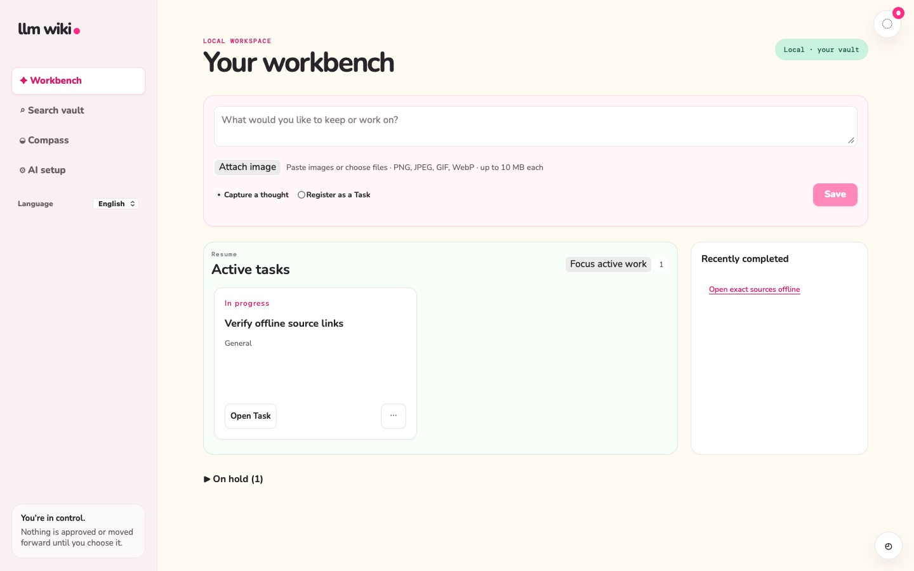
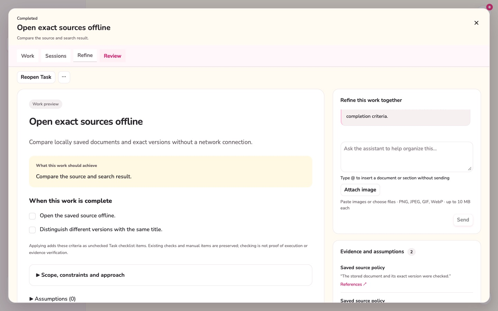
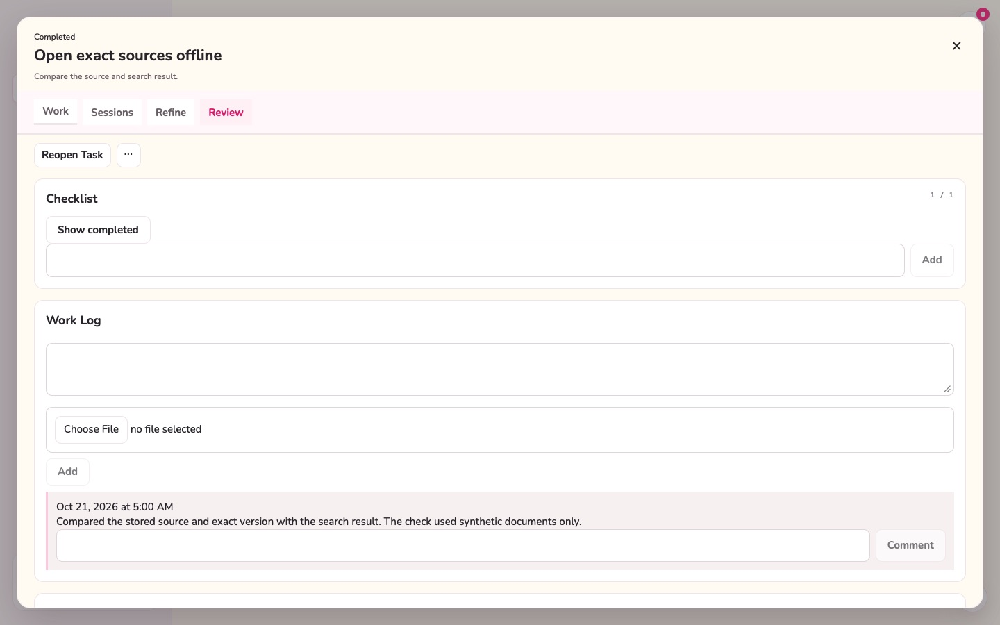
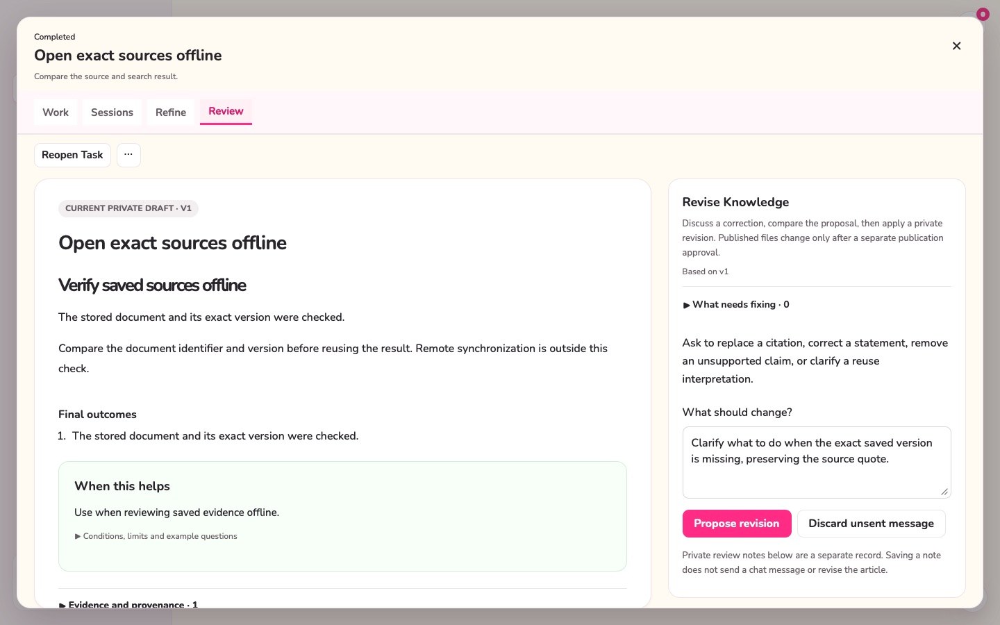
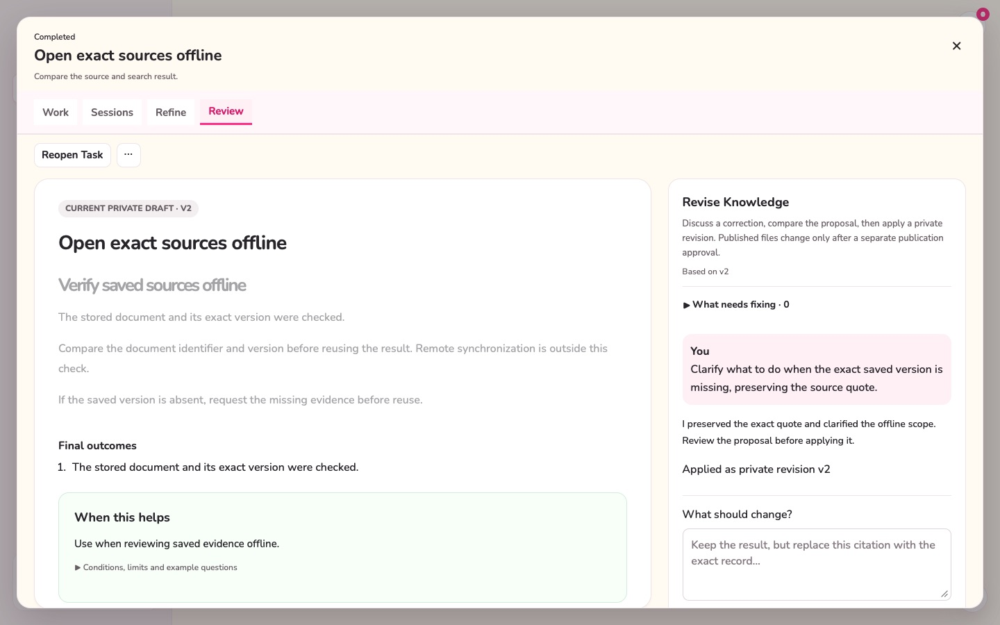

# Current interface guide

**English** | [한국어](visual-guide.ko.md)

Captured on 2026-10-21 from integrated source `584ae3c`. These are the full App
and production runtime rendered in an isolated nonpersistent WKWebView with shared
CSS, bundled fonts and synthetic API responses. They are browser fixture evidence;
no installed application, user database, real model or API key was used.
See the [image audit and reproduction procedure](../testing/documentation-image-audit.md).

## 1. Capture an idea or register a Task

The primary navigation opens **Workbench**, **Search vault**, **Compass** and
**AI setup**. Workbench saves the input as a Capture or registers it as a Task.
Active Tasks, recent completions and held work remain accessible from the board.
**Focus active work** gives current work more space.

*The input sits above active work and recent completions. The held section is collapsed.*

See [Task-centered Workbench](conflict-gated-workflow.md) and
[Automatic Capture organization](capture-auto-distillation.md).

## 2. Refine inside the Task workspace

**Refine** places the saved work preview beside conversation and its evidence rail.
Task definition values remain editable in the preview; the duplicated definition
block has been removed. Review the goal, completion criteria, scope, constraints,
approach and assumptions before applying a preview to the Task.

*The 1440px viewport gives the conversation about 429px. Preview and Knowledge chat
use the same rail width: about 583px at 1920px and 720px at 2560px.*

Type `@` to mention a saved document or section. Exact document versions and source
roles remain distinct. A sent message, discovered source or opened preview does not
apply a proposal. Saved preview edits and explicit Task adoption remain separate.

See [Reference-aware work previews](reference-aware-workbench.md).

## 3. Work in the four Task tabs

The tabs are **Work**, **Sessions**, **Refine** and **Review**. Work holds the
checklist and Work Log. Sessions holds saved work conversations and explicit Codex
runs. Refine holds the preview, definition editing and refinement chat. Review holds
completion and Knowledge review. A chat response does not complete or publish a Task.

*The recorded Work Log describes a synthetic source/version check. A checked item
alone does not prove that work was performed or verified.*

The browser's file chooser follows the host system language; its label can remain
English in a Korean fixture. Product labels and authored fixture text use the stated locale.

See [Task work sessions](task-work-sessions.md) and
[Task lineage and Knowledge](lineage-knowledge-layer.md).

## 4. Revise Knowledge before publication

After completion, Review shows a private Knowledge draft and a separate revision
conversation. Ask for a bounded correction; the request in the image is still unsent.
Private review notes are a separate record and do not send chat messages.

Compare the returned proposal before applying it. Applying appends a private revision;
publication still needs a separate archive proposal and explicit approval of exact files.

*The applied draft remains private. These captures do not demonstrate native publication,
source indexing or a real model's ability to produce a valid correction.*

See [Evidence-bound Knowledge drafts](knowledge-distillation.md),
[Reviewed Knowledge archive](knowledge-archive.md) and
[Completion and Knowledge](completion-writeback-archive.md).

## Historical evidence

The previous `current-*` JPEGs and older PNGs remain unchanged as dated interface
history. Their [native capture manifest](../testing/evidence/current-interface.json),
[language capture manifest](../testing/evidence/docs-language-consistency.json) and
[entry-layout record](../testing/evidence/capture-entry-layout.json) describe their
original baselines, not the current images above. Conflict review remains an
unmounted component/API contract in this baseline; its old screenshots are labeled
historical rather than recreated as an available Task surface.
